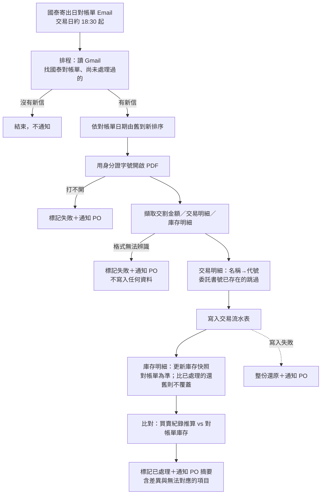
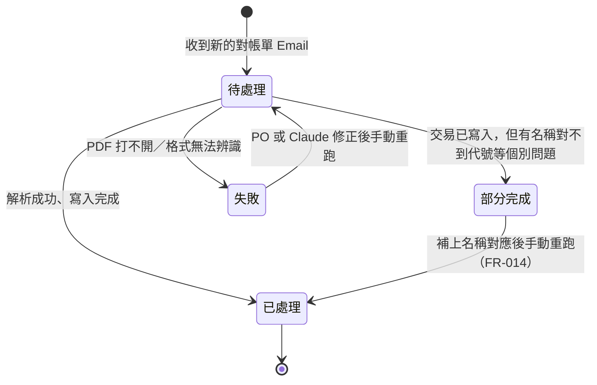
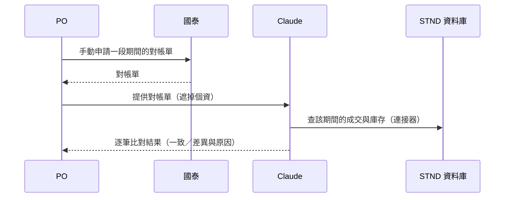

# 流程與狀態：國泰台股日對帳單自動匯入

**Feature Slug:** broker-statement-import
**Last Updated:** 2026-10-31
**Sources:** SRC-001、SRC-002；Q-001～Q-005

## 每日流程

## 每份對帳單的處理狀態

- 同一份對帳單（以對帳單日期＋信件識別）只處理一次；重跑不會產生重複資料
  （成交以委託書號防重複、庫存快照以日期覆寫同一天）。
- 「失敗」時**不寫入任何資料**（整份對帳單全有或全無，交易與庫存不可只寫一半）。
- 「部分完成」只用於個別成交無法對應代號：其餘成交與庫存照常寫入，對不到的成交列在
  通知中，待人工處理。

## 驗證期流程（Q-005：連續 3 次一致即結束，之後不定期抽查）

