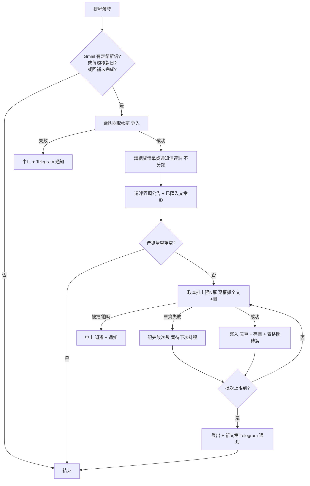

# Workflow And States: 定錨產業筆記文章自動匯入

**Feature Slug:** investanchors-import

## 文章狀態

| 狀態 | 意義 | 轉換 |
|------|------|------|
| discovered | 清單看到、尚未抓 | → fetched／failed |
| fetched | 全文已存 | 終態（內容更新另議） |
| failed | 抓取失敗，待下次排程重試（同次不重試） | → fetched／abandoned |
| abandoned | 累計失敗達上限，停止自動重試並已通知 | PO 處理後手動重置 |
| skipped | 置頂公告 | 終態 |
