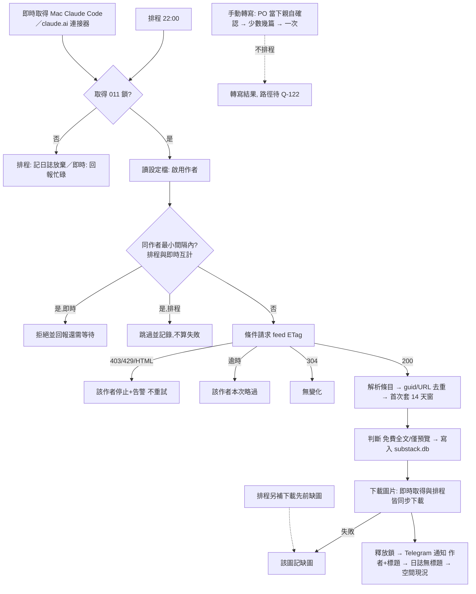
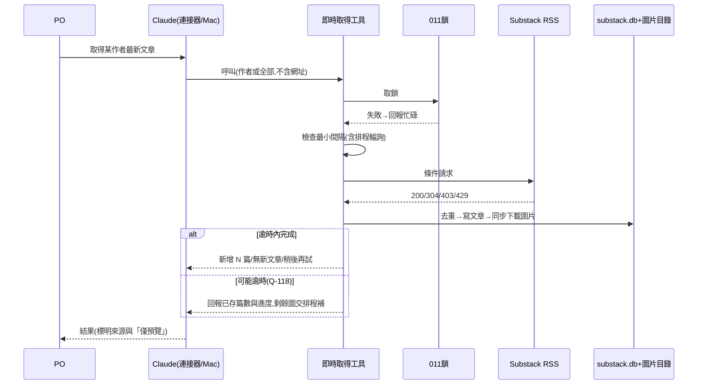
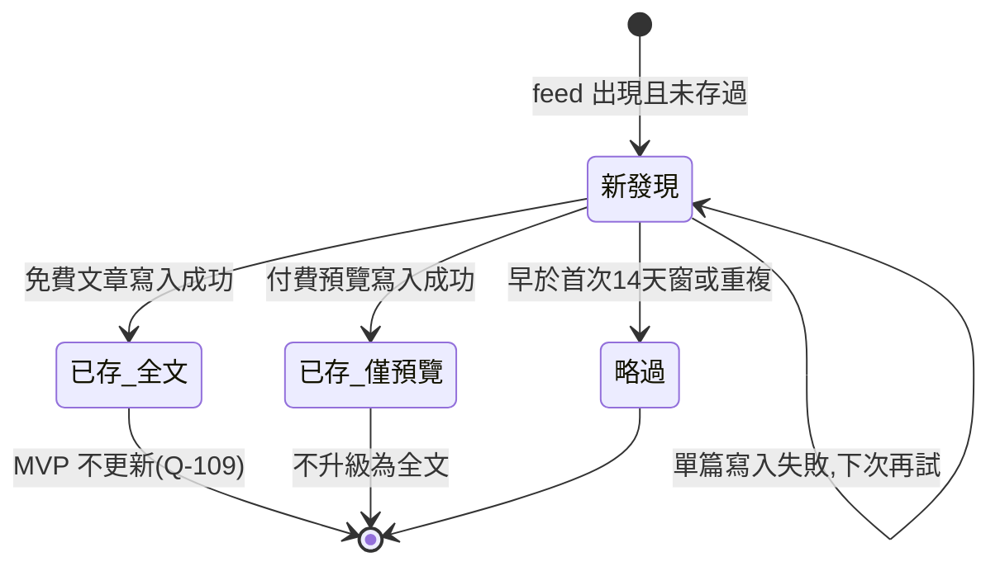
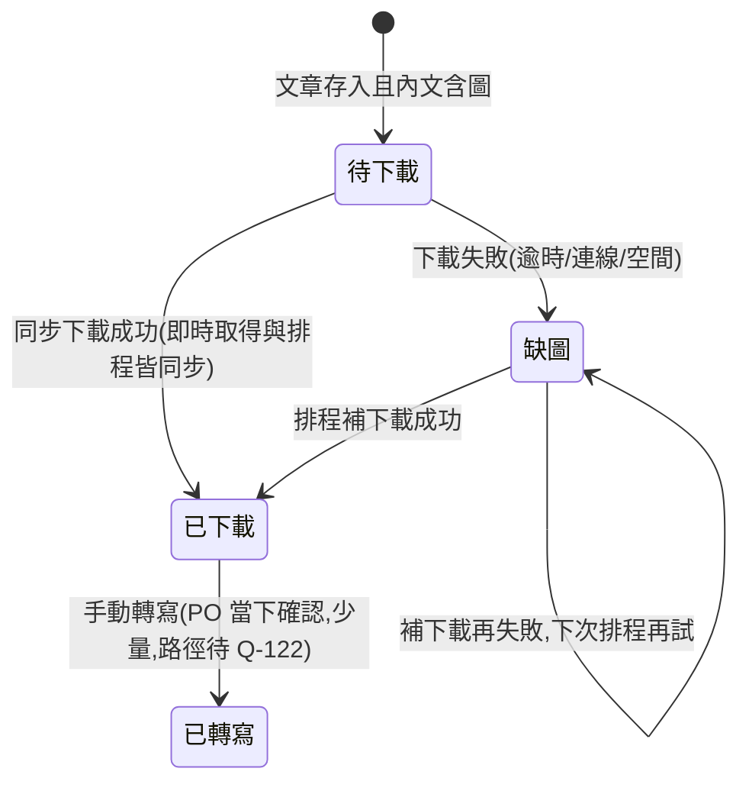

# 流程圖與狀態轉換模型：Substack 匯入（011）

**Feature Slug:** substack-import
**Last Updated:** 2026-11-19
來源：SRC-001、SRC-002（含「追加決定」節）、SRC-003。本檔是產品層級的流程與狀態，不定義實作；數值待規格者標「待」。

## 1. 整體流程（排程、即時取得、手動轉寫）

## 2. 即時取得循序圖（含逾時）

## 3. 文章狀態轉換

## 4. 圖片狀態轉換

## 5. 轉換規則摘要

| 項目 | 規則 | 來源 |
|------|------|------|
| 圖片下載失敗 | 不影響文章存檔；記缺圖；由排程補下載 | 追加決定第5題；FR-008 |
| 補下載無上限重試 | 每次排程僅再試一次，不連續重試（不轟炸圖片主機）；具體上限待規格 | 推論，待規格 |
| 手動轉寫 | 僅手動、不排程；不使 011 文章進入 010 排程流水線 | 追加決定第2題；FR-009、FR-010 |
| 文章不回退 | 已存文章不因圖片狀態變化而被刪除或回滾 | FR-008 |
