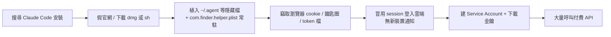

# Mac 資訊竊取木馬（AMOS 類）防護與健檢（2026-11-04）

起因：一篇實際案例——偽 Claude Code 安裝網站（Google 搜尋第一名）植入 AMOS
木馬，潛伏 8 個月後偷走瀏覽器登入 cookie，攻擊者**不需密碼、不觸發 2FA 與新裝置
通知**就冒用身分進 GCP 建 Service Account，再大量呼叫 Vertex AI 產生數萬元帳單。

本 repo 的風險面跟該案高度重疊：PO 的 Mac 上同時有 Claude Code、ngrok 對外常駐、
`ALPHAVIBE_MCP_TOKEN`（放在 MCP 網址路徑裡）、Telegram bot token、FinMind token、
GitHub（standerfly）登入、Google 帳號。



## 1. 本機健檢（唯讀，Mac 上執行）

```bash
# 建議先關 Wi-Fi
bash ops/security/mac-amos-check.sh 2>&1 | tee ~/Desktop/amos-check-$(date +%Y%m%d).txt
```

| 節 | 檢查內容 | 命中代表 |
|---|---|---|
| 1 | `~/.mainhelper`、`~/.pass`、`~/.id`、`~/.agent`、`com.finder.helper.plist` 等已知 IOC | **幾乎確定中毒** |
| 2 | 家目錄根層的隱藏 Mach-O／可執行檔 | 高度可疑 |
| 3 | LaunchAgents/Daemons 指向隱藏檔、/tmp、curl、osascript、`bash` | 可疑常駐（`com.alphavibe.*` 為已知白名單） |
| 4 | 從隱藏路徑或 /tmp 跑起來的行程 | 可疑 |
| 5 | Gatekeeper 隔離資料庫中非官方網域的 claude/安裝檔下載 | 找出當初的釣魚來源 |
| 6 | `claude` 執行檔實際路徑 | 確認是官方安裝 |
| 7 | 歷史指令中的 `curl … \| bash`、`base64 -d`、osascript 密碼框 | 社交工程痕跡 |
| 8 | Gatekeeper／SIP／XProtect 狀態 | 系統防護是否被關閉 |

腳本不刪不搬任何東西。再用 **Malwarebytes for Mac（免費版）** 做全機掃描當第二意見
（原文實測 Malwarebytes、Avast 免費版都抓得到 AMOS）。

## 2. 中毒後處置（第 1 節有命中時；在**另一台乾淨裝置**上做）

順序重要：先切斷攻擊者手上的 session，再換密碼與金鑰。中毒機上換的密碼會再被偷。

1. **Google 帳號**：myaccount.google.com →「安全性」→「你的裝置」→ 全部登出；
   改密碼；檢查「第三方存取權」；用 Google Takeout 的活動紀錄比對陌生 IP。
2. **GCP（每個 project）**：
   - IAM →「服務帳戶」：刪除不認得的帳戶，並看各帳戶「金鑰」分頁；
   - API 與服務：停用沒在用的 Vertex AI / Generative Language API；
   - 帳單：預算警示只會通知不會擋——加上「預算 → Pub/Sub → Cloud Function 停用
     帳單」的程式化硬上限，或對不用的 project 直接解除帳單連結；
   - Logs Explorer 查 `protoPayload.methodName:("CreateServiceAccount" OR "CreateServiceAccountKey" OR "EnableService")`。
3. **本專案相關憑證輪替**：
   - `ALPHAVIBE_MCP_TOKEN`（換新值後重設 claude.ai 台股／美股兩個連接器網址）；
   - ngrok authtoken（ngrok dashboard 重新產生 → `ngrok config add-authtoken`）；
   - Telegram bot token（@BotFather `/revoke`）；
   - `poc/data/finmind_token.txt`（若有）、SerpApi key（若有）；
   - GitHub：撤銷所有 PAT、檢查 SSH keys 與 Authorized OAuth Apps，登出所有 session；
   - Anthropic / claude.ai：登出所有裝置；本機 `claude` 重新登入。
4. **macOS 鑰匙圈與瀏覽器**：AMOS 會偷鑰匙圈與瀏覽器存的密碼、加密貨幣錢包——
   所有存在瀏覽器的密碼都視為外洩。
5. 確認上述完成後再清理中毒機；最乾淨的作法是備份資料後重灌 macOS。

## 3. 平時預防（低成本）

- **只從官方來源裝工具**：Claude Code 只用 `claude.ai/install.sh`、
  `npm i -g @anthropic-ai/claude-code` 或 `brew install --cask claude-code`；
  不點搜尋結果的「廣告」或長得像官網的網域。
- 任何網頁叫你「打開終端機貼這行」或跳出要求輸入 Mac 密碼的對話框，一律先停。
- 開啟 GCP / 雲端的帳單異常偵測與預算警示，不用的 project 解除帳單連結。
- API key 用完即撤、定期輪替；本 repo 已確認沒有把金鑰 commit 進 git
  （2026-11-04 掃描 `sk-`／`AIza`／Telegram／`ghp_`／`/mcp/<token>` 樣式皆無命中）。
- **已排程每週一 10:00 自動跑**（launchd `com.alphavibe.amoscheck`，2026-11-05 起）：
  完整報告存 `~/Library/Logs/amos-check/`（權限 600、保留 26 份），Mac 通知＋Telegram
  只送「命中幾項／比上次新增幾項」，**不送細節**（報告含 shell 歷史）。第 1 節命中會標 🚨。
  - 安裝：`cp ops/launchd/com.alphavibe.amoscheck.plist ~/Library/LaunchAgents/ && launchctl bootstrap gui/$(id -u) ~/Library/LaunchAgents/com.alphavibe.amoscheck.plist`
  - 立即跑一次：`launchctl kickstart gui/$(id -u)/com.alphavibe.amoscheck`
  - 停用：`launchctl bootout gui/$(id -u)/com.alphavibe.amoscheck`
  - 目前已知且合法的 2 項命中：`com.user.claude.heartbeat`（AI-stock-km-v1）、
    `com.visualstudio.code.tunnel`——每週都會出現，看「新增」數字即可。

參考：Huntress〈AMOS stealer〉、Google Cloud〈LLMjacking〉、Tom's Hardware 帳單案例（見原文 Reference）。
