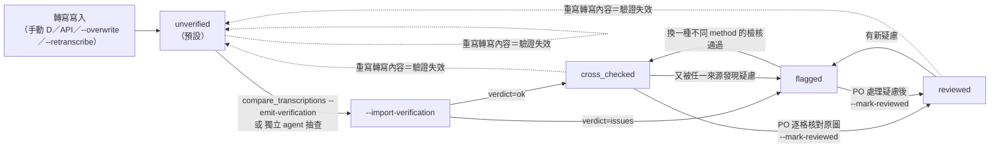

# Quickstart: 定錨產業筆記文章自動匯入

> 規劃階段文件；實作完成後以實測回填「實測」字樣。順序不可跳：**探查 → 抽查轉寫 → 回補 → 日常**。

## 1. 一次性設定（PO）
1. 鑰匙圈（**`-a` 後是固定名稱，`-w` 後不接任何東西**，互動輸入；009 曾誤填）：
   ```bash
   security add-generic-password -U -s stnd-investanchors -a email -w
   security add-generic-password -U -s stnd-investanchors -a password -w
   security add-generic-password -U -s stnd-investanchors -a vision-api-key -w   # 轉寫模型金鑰
   ```
   驗證只能用：`security find-generic-password -s stnd-investanchors -a email >/dev/null && echo ok`。
   **禁止** `dump-keychain`、`-w`、`-g`。Gmail 沿用 `stnd-statement-import`（009 已存）。
2. `cd poc/kb-mcp/scraper && npm install`（若尚未裝）。
3. 確認 Telegram 設定存在：`~/.config/stnd-gateway/.env`。

## 2. Phase 0 探查（**已於 2026-11-15 完成兩次**，結果見 research.md R0 實測回填；以下為執行規約，重跑需 PO 再次同意）
**執行前**：PO 把電腦上的定錨網站**先登出**，只保留手機一台登入（網站規定同帳號最多兩台，探查瀏覽器算一台；
同時登入第三台可能導致帳號被停用）。探查期間不要在電腦開定錨、不要額外做登入測試。結束後確認手機是否仍在線。
`python3 poc/kb-mcp/article_probe.py --data-dir poc/data --confirm-po-present`；把輸出的結構事實回填
`research.md` R0 的 P1～P7。PO 已決定（2026-11-14／15）：(a) 排程**每晚 23:00 一天一次**（2026-11-17 PO 放寬為每日 2 次：12:30 與 23:00，兩次至少間隔 6 小時，見 clarification-log Q-026）、(b) 表格圖送第三方
模型 API **已同意**（Q-016）、(c) 轉寫抽查**抽 10 張、由 PO 本人逐格確認、無百分比門檻**。探查後還需回報 PO：
半年內篇數、每頁篇數與以每天 5 篇回補所需天數（P1／P8；PO 預估約 50～130 篇、11～26 天）、登出機制與名額釋放行為（P2／P2a／P2b）。

## 3. 轉寫抽查與啟用（**部署後**，FR-018；轉寫開關預設關閉）
真實圖片要等部署後回補累積（每次最多 5 篇，每日最多 2 次）。累積 ≥10 張且含長圖後：PO 存金鑰（存了不會啟動轉寫）→ `investanchors_import.py --transcribe-sample 10`（只轉寫抽樣的圖、不寫 DB）→ **PO 本人逐格確認**；PO 認可才採用目前模型，不認可則升級模型再抽 10 張，不設百分比門檻 → 通過後 `--enable-transcription` → `--retranscribe` 補轉積壓。結果寫入本檔「實測」節。

## 4. 回補
排程啟用後，每次至多 5 篇、分多天自動進行，**只補最近半年**（預估約 11～26 天），更早的標記為 `deferred`；
完成後跑 `article_reconcile.py` 與「總覽」清單中半年內的文章逐篇核對（SC-001）。日後要補更早的文章：
`investanchors_import.py --backfill-since <YYYY-MM-DD>`（須 PO 同意放寬）。

## 5. 日常
無新信的日子不登入；新文章 Telegram 通知。從 claude.ai／Claude Code 以 `search_articles`／`get_article` 查詢。
改過 `poc/kb-mcp/*.py` 後，依既有慣例重新部署（`ops/deploy.sh`）並確認 MCP 服務重啟。

## 6. 已知坑（規劃階段已查證）
- **清單每頁頂端有 5 筆置頂項（1 公告＋4 一般文章）在各頁重複**；4 筆置頂文章的清單日期顯示 2021-02-06，但其實是近期
  文章。不得用清單日期判斷新舊或半年截止；以文章 ID 前 13 位（epoch 毫秒＝建立時間）判斷，並有防呆（research R11）。
- **開啟文章會把未讀改成已讀**（FR-009 例外，PO 已接受）；探查時挑未讀文章當對照也會改變 PO 帳號上的已讀狀態。
- **Playwright 預設收到 SIGTERM／SIGINT 會先關瀏覽器**，導致無法登出；scraper 已關閉其內建訊號處理並自行登出再結束。
- 登出在下拉選單內（`a[href=/user/session][data-method=delete]`，不可見）；登入頁有登入／註冊兩個表單，限定在
  第一個可見密碼欄位所屬的 form。
- **通知信中的連結是每位收件人的點擊追蹤轉址（`/c/<token>`），不可跟隨、不可解碼、不取文章 ID**；信只當觸發。PO 表示每篇
  文章都寄信，但實測近 30 天只搜到 12 封（同期文章約 24 篇），原因未驗證——新設計每次登入都抓清單上所有未入庫文章，漏信只延後觸發。
- **探查工具的報告不得含 token**：首次純信箱實跑發現路徑形態只遮數字、字母 token 片段仍進報告，已修（長路徑段一律標 `<token>`）。
- 一篇文章可能只有 1 張很高的長圖（2190×5195），圖片網址不帶 cookie 可下載。
- **FTS5 trigram 搜不到 2 字中文詞**（實測：「環宇」「財測」=0），本功能用 `LIKE`，不要「優化」成 FTS5。
- `setup-plan.sh` 在非 `NNN-` 分支會拒絕：用 `SPECIFY_FEATURE=010-investanchors-article-import`。
- repo 沒有任何登入／storageState／LLM 呼叫先例；這兩塊是全新程式碼，驗收要加倍嚴。
- **PO 待辦（T056，部署後）**：Mac 上 `~/.claude` 的 stock-researcher 白名單**不在 repo**，須由 PO 手動加入 `search_articles`／`get_article` 兩個工具（agent 不修改 `~/.claude`）。
- 工具數守門已於 T029 同步：`test_pnl.py::test_tool_counts`（50／31）、`test_traceability.py::test_tools_list_has_fifty`；台美輸出一致性見 `test_article_connectors_parity.py`。
- 工具數守門有兩處要同步：`test_pnl.py::test_tool_counts` 與 `test_traceability.py::test_tools_list_has_forty_eight`（都 48→50；後者函式名、docstring 也要改）。
- `.gitignore` 沒有祕密檔規則：本設計不產生任何祕密落地檔；探查輸出在已忽略的 `poc/data/` 下。
- 站方「兩台裝置」上限：排程的瀏覽器算一台，PO 手機＋電腦已兩台時，**絕不可與 PO 同時上線**——時段須先問 PO。
- 通知信連結若是追蹤轉址，不要跟隨（見 research P4）。

## 7. 接手備忘（Phase 5 完成時補，2026-11-15）
- **轉寫開關**：`articles.db` 的 `setting` 表鍵 `transcribe_enabled`，`"1"` 開／`"0"` 或無此列＝關。預設關閉不看鑰匙圈。要啟用的順序：PO 存 `vision-api-key` → 部署 → `--transcribe-sample N` 抽查（T059）→ `--enable-transcription`（T060）→ `--retranscribe` 補轉積壓（T061）。
- **T036 的 `x-api-key`＋`anthropic-version: 2026-10-21` 從未對真實 API 驗證過**；第一次真實請求會是 `--transcribe-sample`。失敗（401／400 格式錯）時先看 research R5 的 T033 小節，不要改模型。
- **切片器沒有對 Importer 預設路徑做過端到端整合**：`article_image_tiles.py` 本身有 Playwright 測試（2190×5195、縮圖、超過 8 片），Importer 的長圖路徑在測試中用假 runner 注入；空白帶門檻（99%、容差 10、連續 ≥4 列）只用合成圖調過，抽樣時留意長圖切片品質。
- **abort 規則**：金鑰缺失／401／402／403／額度型 400 → 該圖與本次後續圖留 `untranscribed`，`--retranscribe` 補；abort 只在同一個 Importer 實例內有效。
- **`--retranscribe` 處理對象**：`untranscribed`，加上 `transcribed_model` ≠ 目前模型的 `done`；`not_table` 不重轉。
- **轉寫沒有圖片間延遲**（只有下載有 5～15 秒間隔）；模型 API 呼叫節奏未特別限制，量大時留意 429。
- **測試慣例**：要證明「沒讀金鑰」就沿用 `test_investanchors_transcription.py` 的 `Env`（包裝 `get_secret` 計數）；該測試依賴 `test_article_image_tiles`／`test_article_transcribe` 的輔助函式，改名要同步；同日第二次登入會被低頻守衛拒絕，測試要推進時鐘。
- **macOS 路徑**：`/var` → `/private/var`，比對路徑一律用 `os.path.realpath`（已踩過兩次）。
- **本機測試目錄**：`poc/data-test-articles/`（已被 `.gitignore` 涵蓋）內有 T023 真實抓的 1 篇＋1 張 1653×993 圖，供 US3 抽查與 US4 試跑用，不要刪。

## 8. 實測回填與進度（2026-11-16）
- **T023 真實單篇執行（已完成）**：登入 1 次、讀清單 3 頁；discovered 44、fetched 1、skipped 1（公告）；`logged_out=1`；
  圖片 1 張（1653×993）；外洩檢查 0。資料在 `poc/data-test-articles/`（測試庫，非正式庫）。
- **程式進度**：T033～T047 程式完成；US3（轉寫）與 US4（回補）已通過全新 agent 獨立驗收（程式行為；真實轉寫模型與
  真實回補尚未驗證）。T048 真實回補試跑已於 2026-11-16 完成（5 篇、logged_out=1、外洩 0）。T049～T051（plist、巡檢 `check_investanchors_import`、文件）完成後，
  剩 T052～T056。

## 9. 上線步驟（T055，PO 在場同意後依序執行）
1. 提交推送（T054 主對話最後審查通過後）。
2. 備份（`ops/deploy.sh` 慣例）。
3. 部署到 `AlphaVibe-prod` 並重啟：`cd /Users/stander/My_project/AlphaVibe-prod && git fetch origin function/alphavibe && bash <(git show origin/function/alphavibe:ops/deploy.sh)`；改過 `app/` 與 `poc/kb-mcp/*.py`，確認 MCP 連接器已套用。
4. 安裝 plist：複製 `ops/launchd/com.alphavibe.investanchorsimport.plist` 到 `~/Library/LaunchAgents/` 後 `launchctl bootstrap gui/$(id -u) <plist>`（plist 已帶 `ALPHAVIBE_ALLOW_PRODUCTION_WRITE=1`，因 prod 的 `poc/data` 是 symlink）。
5. 用 launchd 實跑一次驗證（`launchctl kickstart gui/$(id -u)/com.alphavibe.investanchorsimport`），看 log 與 `check_scheduled_jobs.py` 的 `investanchors_import` 項。
**正式庫的轉寫開關維持預設關閉**；回報實際結果，不假設已上線。

## 10. 唯讀查詢範例（T057 用；一律 `-readonly`，不寫入）
```bash
DB=poc/data/articles.db
# 累積圖片張數（只計已入庫文章）
sqlite3 -readonly $DB "select count(*) from article_image i join article a on a.article_id=i.article_id where a.status='fetched';"
# 長圖張數：不在 SQL 內判定，用抽查工具（--transcribe-sample）依圖片尺寸判定
# import_runs 摘要（最近 10 次）
sqlite3 -readonly $DB "select id, started_at, trigger, logged_in, login_ok, list_pages, articles_fetched, result, logged_out, blocked_until from import_runs order by id desc limit 10;"
# abandoned 與 id_time_ok=0 計數
sqlite3 -readonly $DB "select status, count(*) from article group by status;"
sqlite3 -readonly $DB "select count(*) from article where id_time_ok=0 and status!='skipped';"
# 未轉寫與已達上限（3 次）張數
sqlite3 -readonly $DB "select count(*), coalesce(sum(i.transcribe_attempts>=3),0) from article_image i join article a on a.article_id=i.article_id where a.status='fetched' and i.transcription_status='untranscribed';"
# 轉寫開關（無此列＝關）
sqlite3 -readonly $DB "select value from setting where key='transcribe_enabled';"
```

## 11. 備份與圖片重抓（2026-11-16，PO 決定）

- **決定**：`articles.db` 納入每日備份（`poc/kb-mcp/backup_databases.py` 的 `OPTIONAL_DATABASES`；庫尚不存在時略過、不算失敗、不建檔；輪替與既有庫相同：每日留 30、每月 1 號收進 monthly 留 24）。**`articles_images/` 不備份**（圖片只是備份用途，需要時回定錨網站重抓）。
- **「對指定文章重抓圖片／表格」：目前沒有此能力，需另開。** 讀程式的結論：
  - `article_images.download_images` 只下載 `file_path` 為空的圖（`article_images.py:58-59`，`if img.get("file_path"): continue`）。圖檔被刪但資料庫 `file_path` 仍有值時，**不會**被補抓。
  - 「下載失敗保留 NULL、下次補抓」只在註解中承諾（`article_images.py:8`、`investanchors_import.py:815`）；`ArticleStore.images_missing_file()`（`article_store.py:426-428`）除測試外**沒有任何呼叫端**（grep `poc/kb-mcp/*.py` 僅此定義）。下載圖片的唯一入口是 `_images`（`investanchors_import.py:809-814`），只在文章剛抓取成功後呼叫（`:773`）。
  - 已抓取（`fetched`）的文章不會被重抓：處理迴圈只接受 `PENDING_STATUSES = ("discovered", "failed")`（`article_store.py:34`；`investanchors_import.py:760-762`）；`--reset-abandoned` 只把 `abandoned` 重置為 `failed`（`article_store.py:245-251`），不適用 `fetched`。
  - `--retranscribe` 只讀本機圖片、不登入、不下載（`investanchors_import.py:341-342`；說明見 `:126-127`），且只處理 `file_path IS NOT NULL` 的圖（`:350`、`article_store.py:469`），圖檔不在就無從轉寫。
  - 重抓文章本身需登入網站，且受每日 2 次（間隔 ≥6 小時）／每次 5 篇限制（`investanchors_limits.MAX_ARTICLES_PER_RUN`，見 `--max-articles` 說明 `investanchors_import.py:113-114`）。
  - 最接近的現有行為：只有「剛抓取成功的那次」會下載圖片。若要支援，需新增「對 `fetched` 文章重置並重抓」或「依 `images_missing_file`／檔案不存在補抓」的功能，並由 PO 決定受限流約束。

## 12. 方案 D 操作手冊：手動轉寫（2026-11-18，PO 決定，Q-027）

**是什麼**：表格圖要轉成文字才搜尋得到。先不用付費 API 與金鑰：PO 請 agent（Claude Code、Cline 等，用它們內建的讀圖能力）把「未轉寫的圖」轉成文字，再匯入資料庫。**全程不呼叫任何外部 API、不讀鑰匙圈、不登入定錨、不連網。**

**與 `transcribe_enabled` 的關係**（程式查證結論）：開關**只管「匯入排程是否自動呼叫外部 API 轉寫」**；顯示與搜尋已存在的轉寫文字**完全不看開關**（`article_tools.py`、`ArticleStore.search_articles` 都沒有判斷它）。所以方案 D：開關維持關閉即可，匯入不改開關，匯入後 `get_article` 立刻看得到（附未驗證警告）；**但 `search_articles` 要等轉寫通過驗證（cross_checked／reviewed）才搜得到，見 §14（2026-11-18 起）**。日後若打開開關跑 API 轉寫，`--retranscribe` 的換模型重轉**不會**覆寫 `manual:` 的列。

### PO 要做的（建議一天一次、每次 10 張內）
1. 匯出（唯讀，不登入）：
   `python3 poc/kb-mcp/investanchors_import.py --data-dir <資料目錄> --export-untranscribed [--limit 10]`
   會印出資料夾 `<資料目錄>/articles_probe/manual-transcribe-<時間>/`（正式庫需 `ALPHAVIBE_ALLOW_PRODUCTION_WRITE=1`；先在測試目錄 `poc/data-test-articles` 試）。
2. 把該資料夾交給 agent，一句話即可：「請依 AGENT_GUIDE.md 讀這個資料夾的圖，把結果寫成同資料夾的 results.json」。
3. 預覽（預設不寫入）：
   `python3 poc/kb-mcp/investanchors_import.py --data-dir <資料目錄> --import-transcription <資料夾>/results.json`
   看「將寫入幾筆、略過幾筆、每筆長度」；任何驗證不通過會整批拒絕並說明是第幾筆、哪個 image_id。
4. 確認後加 `--apply` 寫入（單一交易，全有或全無）。已轉寫的圖預設略過；要覆寫才加 `--overwrite`。
5. **抽查**：每批至少挑 2～3 張（含長圖）逐格對照原圖——原圖路徑在 manifest 的 `path`，或用 `get_article` 看圖片清單的「本機路徑」；比對數字、單位、欄位對齊、有無漏列或重複列。不認可就用 `--overwrite` 重匯入（或請 agent 重做那幾張）。標準比照 Q-020（累計 10 張含長圖由 PO 本人確認）。

### agent 要做的（`AGENT_GUIDE.md` 已寫在匯出資料夾內）
逐項讀 manifest 的 `view_files`（短圖＝原圖、長圖＝切片），表格轉成 Markdown 表格、看不清楚的格寫 `?`、**不猜測、不補數字、不加原圖沒有的資訊**，長圖把各片合併成一張圖一份文字（重疊列只留一次），寫出 results.json（`model` 必須是 `manual:<agent 名稱>`，`sha256` 原樣抄 manifest）。**不得修改圖檔或 manifest、不碰資料庫、不連網。**

### 長圖與降級
長圖會用既有切片邏輯產生切片（需要 Playwright＋瀏覽器，通常在 Mac 上才有）。沒有瀏覽器（例如 Linux 容器）時不會失敗：manifest 該項 `tile_status=unavailable`、`view_files` 只有原圖，指南要求 agent 自行分段檢視、看不清楚的格寫 `?`——品質較差，建議在有瀏覽器的環境匯出長圖。

### 安全注意
- agent 讀的是**付費文章圖片**：匯出資料夾（在 `articles_probe/`，已 gitignore）只留本機，**不要貼到公開處或第三方服務**；manifest 不含標題與內文，但圖片本身就是內容。
- 匯入只認 manifest／資料庫裡真實存在、sha256 與目前圖檔一致的圖；拒收控制字元與疑似金鑰／token 的字串；錯誤訊息與預覽輸出都不回顯轉寫內容。
- 稽核：每次 `--apply` 在 `articles.db` 的 `alert_log` 留一筆（`kind=manual_transcription_import`，只含數量與 model，不含內容）：
  `sqlite3 -readonly <資料目錄>/articles.db "select * from alert_log where kind='manual_transcription_import';"`
- 辨識來源：`get_article` 會標示「【圖片轉寫，手動（agent：…），可能有誤，請以原圖為準】」；資料庫 `article_image.transcribed_model` 以 `manual:` 開頭者即手動轉寫。

## 13. D 與 C 比對（2026-11-18；`compare_transcriptions.py`）

**是什麼**：同一批表格圖，方案 D（agent 讀圖寫的 `results.json`）與方案 C（PaddleOCR 評估報告 `paddle-eval-*.md`，見 `paddle-setup.md`）各轉寫一次，本工具把兩邊對照，**優先列出數字差異**，讓 PO 對照原圖只看有疑慮的格子。純本機、不連網、不讀鑰匙圈、不登入、不碰資料庫；只讀三種檔案、只寫一份新報告。

### 操作
```bash
python3 poc/kb-mcp/compare_transcriptions.py \
  --d-results <manual-transcribe-資料夾>/results.json \
  --c-report <paddle-eval-A>.md [--c-report <paddle-eval-B>.md ...] \
  --out <輸出資料夾> [--manifest <manifest.json>] [--numeric-tol 0.01] [--normalize-text]
```
- `--manifest` 預設用 results.json 同資料夾的 `manifest.json`（提供 image_id → 原圖路徑與尺寸）。
- C 報告可多份；每份報告裡的每個模式（`ocr_grid`／`table_pipeline`）各算一個來源（C1、C2…），server／mobile 各跑一份報告即可並排。以**原圖路徑（先完整路徑、再 basename）**把 D 與 C 配對，對不上的列在報告「未配對」。
- 輸出 `<out>/compare-<時間>.md`（不覆寫，同一秒加序號）；stdout 只印數字摘要（張數、疑似錯置高／中／低、逐格差異數、報告路徑）。錯誤輸入（壞 JSON、缺檔、`--out` 指到檔案…）以退出碼 2 乾淨結束。
- `--numeric-tol`：數值相對容差，預設 0＝必須完全相同；`--normalize-text`：非數字文字比較前去空白、小寫、簡繁字形歸一化。

### 如何解讀報告
1. 先看「總結」表與「建議優先核對的圖」（依高→中疑似錯置、逐格數字差異、只在單邊的數字排序）。
2. 每張圖的**疑似錯置**是核心：把一邊有、另一邊沒有的數字配成「看起來是同一個」——**高**＝小數點／千位逗號錯置（24,417.0 vs 24.417.0、20.8% vs 208%）、數量級差、正負號或括號掉了；**中**＝位數差 1（1,234 vs 1,23）或個別數字不同；**低**＝僅格式（24,417.0 vs 24417）。
3. 形狀相同做**逐格對照**；形狀不同改用「列標籤（第 1 欄）＋欄標頭（第 1 列）」對齊；對不上就只做數值集合比對並註明原因（常見：合併儲存格展開方式不同）。
4. `[?]`（D 指南用的 `?` 也算）與 C 的低信心格會列出位置——這些格子本來就待確認。
5. 文字（非數字）差異標**低優先**；簡繁、空白差異用 `--normalize-text` 消掉。
6. **一致不代表正確**：D 與 C 可能犯同樣的錯；不一致也不代表哪邊對。核對步驟：開原圖，只看列出的格子（位置＝列、欄，表頭列算第 1 列、分隔列不算），以原圖為準；D 錯就用 §12 的 `--overwrite` 重匯入。
7. `--emit-verification <路徑>` 可把比對結果輸出成 verification.json（`method=compare-d-c`），見 §14；**雙來源一致不代表正確**。
8. 限制：數值比較以格子文字為準。**百分號有／無不同列為「中」**（單位可能遺漏）；**千位逗號分組不合法**（如 `12,34`、`2,00`）視為異常、不與 `1,234`／`200` 判為一致；`24417` 與 `24,417`（合法分組、數值相同）視為一致；括號負數 (1,234) 與 -1,234 同為 -1234，但**字母／中文緊貼的括號**（如 台積電(2330)）是代號註記、不算負數；日期與年份仍會被抽成數字，兩邊格式不同時（2025.12.31 vs 2025/12/31）會有雜訊；形狀不同又對不上標頭時，只能做數值集合比對，兩格互換之類的位置錯誤偵測不到（對照原圖時請多看）。輸入檔不跟隨符號連結、上限 8MB；D 判為非表格圖者在報告開頭註明。報告含轉寫片段（付費文章圖片來源）只留本機，**不含文章標題**（非表格文字行內容不輸出，只取其中數字）。

## 14. 轉寫驗證等級與抽查流程（2026-11-18，PO 決定，Q-028）

**為什麼**：轉寫會被拿來做投資討論，**資料錯誤是最嚴重的錯**。單一來源（agent 或 API）可能犯一貫的錯——PO 實測就發現過「備註被截成廠務」這種截斷。所以每張圖的轉寫有一個**驗證等級**，沒驗證過的不進搜尋。

### 等級與流程


| 等級 | 意義 | 怎麼來 | `search_articles` | `get_article` 單篇顯示 |
|---|---|---|---|---|
| `unverified` | 沒有任何檢核（預設） | 任何新轉寫寫入；舊庫沒有驗證表時全部視為此級 | **不納入** | 顯示轉寫＋醒目警告「【未驗證／有疑慮的圖片轉寫：數字可能有誤，不得用於投資判斷，請對照原圖】」 |
| `flagged` | 任一檢核發現疑慮 | `--import-verification` 的 `verdict=issues` | **不納入** | 同上警告＋「疑慮摘要」與前 10 項位置（不含標題） |
| `cross_checked` | ≥1 個獨立來源檢核通過 | `--import-verification` 的 `verdict=ok` | 納入 | 標示「已交叉驗證」與方法、驗證者、時間；提醒雙來源一致不代表絕對正確 |
| `reviewed` | PO 本人逐格核對確認 | **只有** `--mark-reviewed` | 納入 | 標示「PO 已逐格核對」 |

台股與美股連接器輸出逐字相同；**沒有新增 MCP 工具**（台股 50／唯讀 31／美股 10 不變）。標題與內文搜尋不受影響。

### 狀態轉換規則（防呆）
- **寫入新轉寫一律重置為 `unverified` 並清除舊疑慮記錄**（`--overwrite`、`--retranscribe` 換模型重轉、重新匯入都一樣：內容變了，舊驗證失效；與轉寫在同一交易內，整批 rollback 時驗證也不會被清掉）。被略過、內容沒變的圖，驗證維持。
- `reviewed` **只能**由 PO 的 `--mark-reviewed` 設定；自動流程與 `--import-verification` 都不會寫 reviewed（`method=po-review` 也不在驗證匯入白名單內）。
- `verdict=issues` 永遠生效（含把 `cross_checked`／`reviewed` 降為 `flagged`）；`verdict=ok` **不會動 `reviewed`**（略過）。
- **防洗白**：`flagged` 要轉 `cross_checked`，`method` 必須不同於**任何曾標過疑慮的來源**（`flag_history` 累計，不會因為換成別的來源標疑慮而被清掉）；同一路徑重跑一次「ok」不會洗掉疑慮，預覽與結果都會列出略過原因。轉換會記在 `note`。
- 非表格圖（`not_table`）：`verdict=issues` 會標 `flagged`（例如 C 轉出了表格內容、D 判為非表格），`get_article` 會在該圖下顯示警告；`verdict=ok` 略過（沒有轉寫文字可驗證）。尚未轉寫（`untranscribed`）的圖不接受驗證，整批拒收。

### 資料層（不改既有欄位）
新增表 `transcription_verification`（見 data-model.md）。MCP 連接器以唯讀（mode=ro）開庫，**部署後正式庫在第一次可寫連線之前可能還沒有這張表**：唯讀查詢遇到表不存在視為「全部 unverified」——搜尋不納入任何轉寫文字、`get_article` 全附警告、健檢全算未驗證，**不出錯、不建表**。表只在可寫連線（匯入排程、`--import-verification --apply`、`--mark-reviewed --apply`）建立。搜尋實作仍是 LIKE：轉寫文字那一支改為「與驗證表 JOIN、僅 `cross_checked`／`reviewed` 且 `transcription_status='done'`」，其餘（標題、全文）不變；沒有 FTS 索引或觸發器需要處理。

### 流程一：D 對 C 比對自動產生驗證檔
```bash
python3 poc/kb-mcp/compare_transcriptions.py --d-results <manual-transcribe-資料夾>/results.json \
  --c-report <paddle-eval>.md --out <輸出資料夾> --emit-verification <輸出資料夾>/verification.json
```
- `method=compare-d-c`、`verifier=compare-transcriptions`。判定：該圖在**所有成功比對的 C 來源**都沒有高／中疑似錯置、沒有「只在單邊」的數字、沒有逐格數字差異、D 沒有 `[?]` 存疑格、形狀不同時標頭對齊成功 → `ok`；任何疑慮 → `issues`（`where`／`found`／`expected`／`kind` 由疑似錯置與差異摘要而成）；D 判為非表格而 C 有內容 → `issues`；比對失敗、未配對、兩邊都沒有數字可比的圖**不輸出**（維持 unverified）。
- **雙來源一致不代表正確**：兩個引擎可能犯同樣的錯；非數字文字差異（例如備註被截斷）**不在判定內**（OCR 雜訊太多）。所以 compare 的 `ok` 只升到 `cross_checked`，文字欄位仍要靠 agent 抽查（流程二）與 PO 核對。
- 匯入：`python3 poc/kb-mcp/investanchors_import.py --data-dir <資料目錄> --import-verification <verification.json>`（預設只預覽；確認後加 `--apply`）。

### 流程二：用 Cline agent 做獨立抽查
1. 匯出（唯讀、零網路、不登入）：
   `python3 poc/kb-mcp/investanchors_import.py --data-dir <資料目錄> --export-verification-task [--limit 10] [--only-unverified]`
   產生 `<資料目錄>/articles_probe/verify-task-<時間>/`：`manifest.json`（image_id、sha256、原圖路徑、尺寸、待查轉寫檔路徑與行數）、`transcriptions/<image_id>.md`（Markdown 表格，**每行前有 `[L012]` 行號**）、`VERIFY_GUIDE.md`、長圖切片（沒有瀏覽器時降級，同方案 D）。預設含 unverified／flagged／cross_checked、不含 reviewed；`--only-unverified` 只取未驗證。**不含文章標題與內文**。
2. 在 Mac 的 VS Code 開 **Cline 擴充**（用與產生轉寫的 agent 不同的模型更獨立），開啟該資料夾，一句話：「請讀 VERIFY_GUIDE.md 與 manifest.json，逐張對照原圖檢查轉寫，把結果寫成同資料夾的 verification.json」。Cline 讀圖需要它所設定的模型支援視覺輸入。
3. agent 會**逐列逐格**核對、**逐字比對文字欄位是否截斷或漏字**、核對每個數字；看不清楚的格子不猜，該圖就記 `issues`（`found` 以 `uncertain：` 開頭）；不得修改轉寫、不得擅自更正原圖筆誤（筆誤另記 `kind=other`）。
4. 預覽匯入（零寫入）：`python3 poc/kb-mcp/investanchors_import.py --data-dir <資料目錄> --import-verification <資料夾>/verification.json`——會列出每張圖將變成什麼等級、略過的原因（不印疑慮內容）。確認後加 `--apply`。
5. `flagged` 的圖：PO 對照原圖修正（`--import-transcription --overwrite` 重匯入，會重置為 unverified 再走一輪驗證），或確認轉寫其實正確。
6. PO 本人逐格核對後：`python3 poc/kb-mcp/investanchors_import.py --data-dir <資料目錄> --mark-reviewed 12,13 --apply`（預覽為預設）。

> **資料外送提醒**：抽查時圖片會被送到該 agent（Cline）所設定的**模型供應商**。這些是付費文章圖片——請先確認該供應商的資料政策（是否保留、是否用於訓練），不確定就不要送；本機模型或已簽資料保護條款的供應商較妥當。匯出資料夾（在 `articles_probe/`，已 gitignore）只留本機。

### 建議的核對節奏（**建議，PO 尚未確認**）
頭兩週每張轉寫都由 PO 逐格核對（`--mark-reviewed`）；之後每 10 張抽 1 張。比例與節奏由 PO 日後決定，確認後回填 Q-028。

### 健檢與稽核
- `check_scheduled_jobs` 的 `investanchors_import` 摘要多一段「未驗證轉寫 N 張、有疑慮 N 張、已驗證 N 張、PO 已核對 N 張」（只計已轉寫的圖；舊庫沒有驗證表時全部算未驗證）。
- 每次 `--import-verification --apply`、`--mark-reviewed --apply` 在 `alert_log` 留一筆（`kind=transcription_verification_import`／`transcription_mark_reviewed`，key 只含時間、method 與數量，**不含 issues 內容**）。
- 查詢範例（唯讀）：`sqlite3 -readonly <資料目錄>/articles.db "select status, count(*) from transcription_verification group by status;"`
